# Worldbuilding

An Obsidian plugin for novelists and worldbuilders. It provides character sheets, a character creation wizard, and an in-world timeline. All data lives in note frontmatter, so it stays plain Markdown, works with Dataview, and syncs.

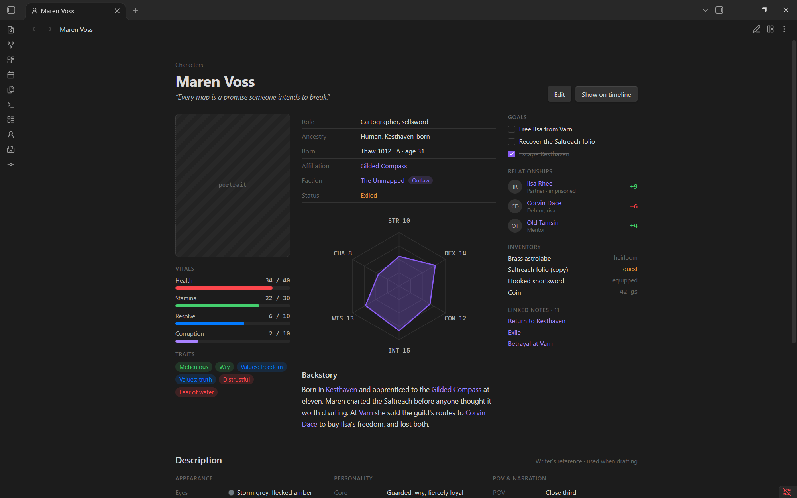

## Features

### Character sheet

Notes with `type: character` open as a sheet. The **Full** layout has three columns (portrait, vitals, traits | properties, stat radar, backstory | goals, relationships, inventory, linked notes) plus a Description section. The **Dossier** layout has a header and tabs. Pick the default in settings or switch per view with the layout button.

- Click a vital's value to edit it (`34 / 40`). Click a goal's checkbox to toggle it. Click the portrait to pick an image from the vault.
- The **wand** button next to **Edit** reopens the note in its form editor, pre-filled: the creation wizard for characters, the city editor for cities. It is also in the view header, the file menu, and the command **Edit current note in wizard**. Saving writes changes back in place and keeps any frontmatter the form doesn't manage (vitals, inventory, custom keys). Changing the name renames the file, and Obsidian updates links to it.
- **Edit** switches to the Markdown editor. Use the person icon in the editor's header to go back to the sheet.

| Full layout: Description section | Dossier layout |
| --- | --- |
| 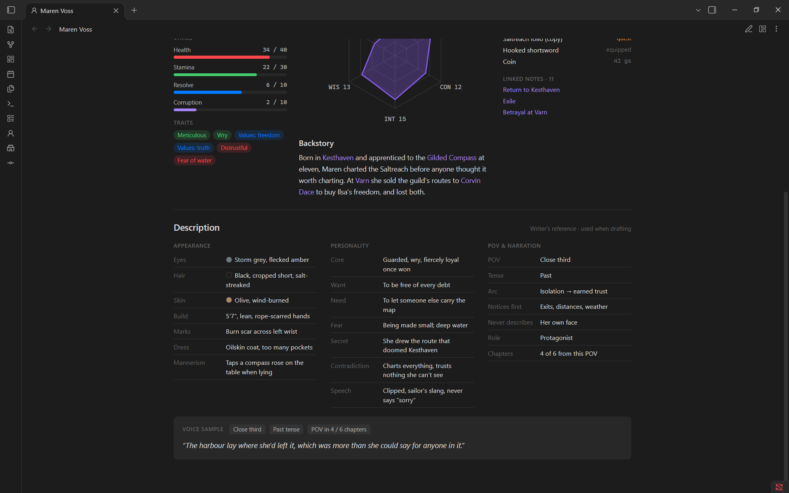 | 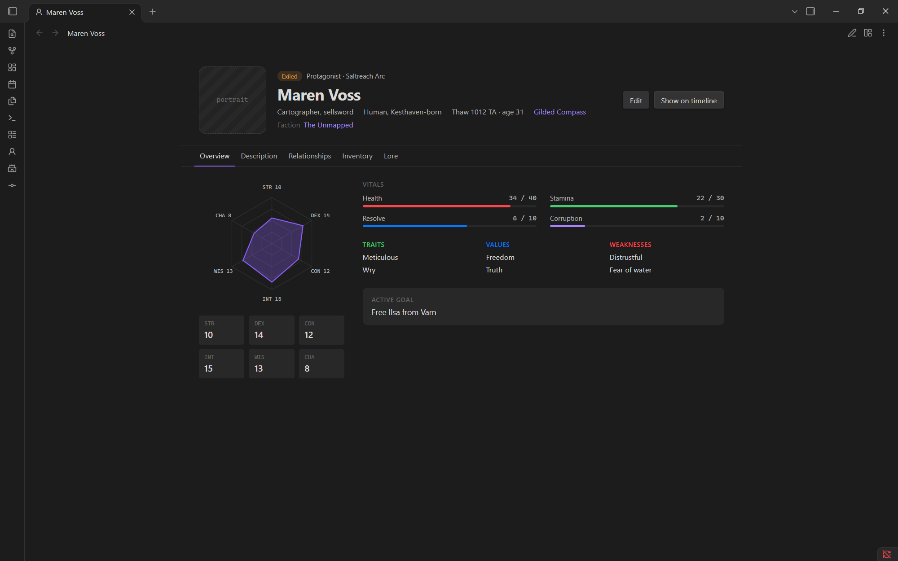 |

### City sheet

Notes with `type: city` open as a sheet: the name and motto, a gallery of 3–5 images (the first one larger; click an image to view it full size, use the arrow keys to browse, hover to remove one, or click an empty slot to add one), the description from the note body, an "At a glance" table, configurable tables (districts and landmarks by default), notable people, and the events that take place there. Create one with **Create new city** or the castle ribbon icon.

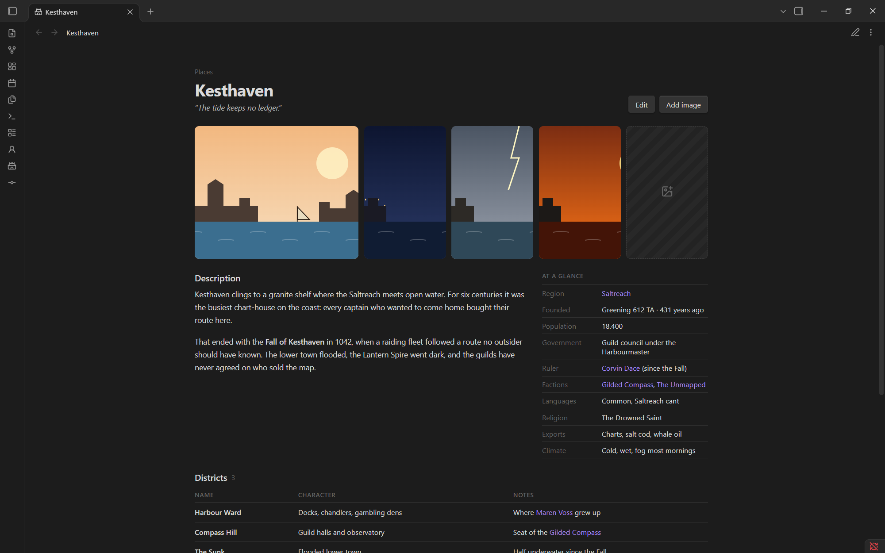

| Tables, notable people and events | New city dialog |
| --- | --- |
| 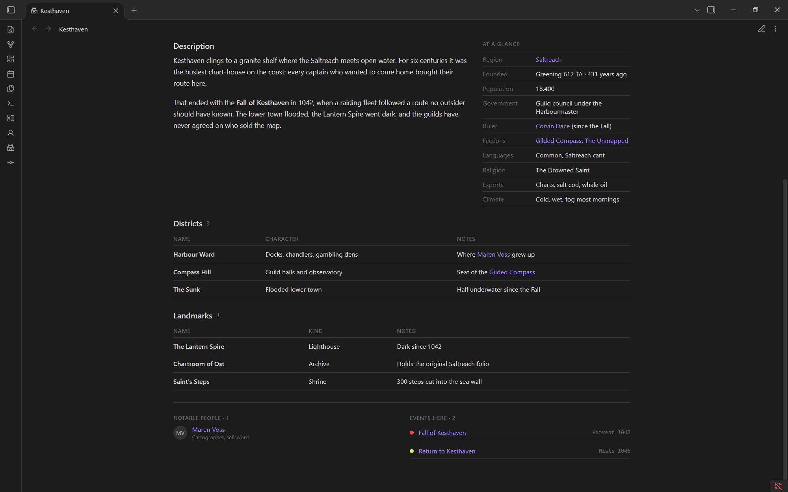 | 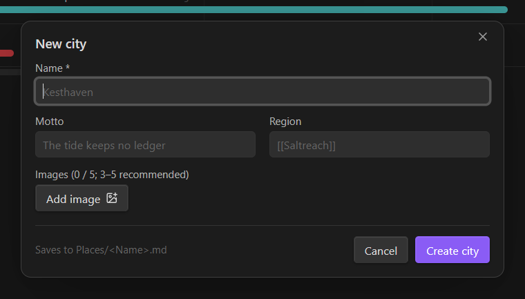 |

### Species sheet

Notes with `type: species` open as a sheet built like the city sheet: the name and epithet, the same 3–5 image gallery, an Overview next to an "At a glance" table (classification, habitat, lifespan, diet…), then one card per section: Appearance, Biology, Behaviour, Culture, Society, Ecology and History by default. Below those come configurable tables (variants and abilities by default), notable members (characters whose notes link to the species, plus any you list), and the other notes that mention it. Create one with **Create new species** or the paw-print ribbon icon.

Sections are plain `## Heading`s in the note body, so you can also write them directly in Markdown. The species editor shows one text box per section; empty sections are left out of the note, and headings that aren't in your section list are kept as they are.

### Faction sheet

Notes with `type: faction` open as a sheet built like the city sheet: the name and motto, the image gallery, an Overview next to **Standing** (a power meter from 0 to 10 and a reputation meter from −10 to +10; click a pip to set either) and an "At a glance" table (leader, type, founded, seat, ideology…). Below those come:

- **Goals**, a checklist you can tick on the sheet
- **Territory**: places listed under `territory` ("held"), plus cities that list the faction under `factions` ("present")
- Configurable tables (resources and ranks by default)
- **Members**: characters whose `faction` or `affiliation` links to the faction, anyone listed under `members`, and the leader. Each shows the character's `faction_tag` (or "Affiliate" for an affiliation)
- **Allies and rivals**: factions listed under `allies` and `rivals`, plus factions that list this one in theirs, marked "mutual", "listed by them", or with the stance they claim when the two sides disagree

Create one with **Create new faction** or the flag ribbon icon.

### Creation wizard

Use the **Create new character** command or the ribbon icon. It has six steps: Identity, Attributes (point-buy, base 8, range 3–18, pool 26), Description, Traits, Relationships and Lore. It writes `Characters/<Name>.md`.

| Identity | Attributes |
| --- | --- |
| 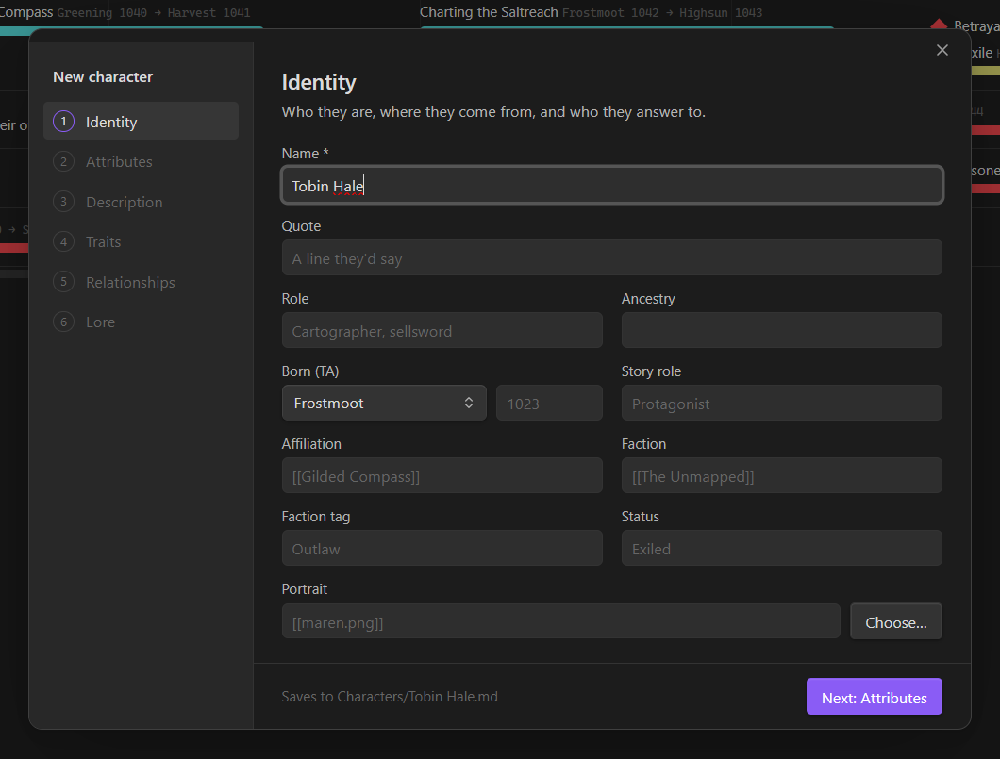 | 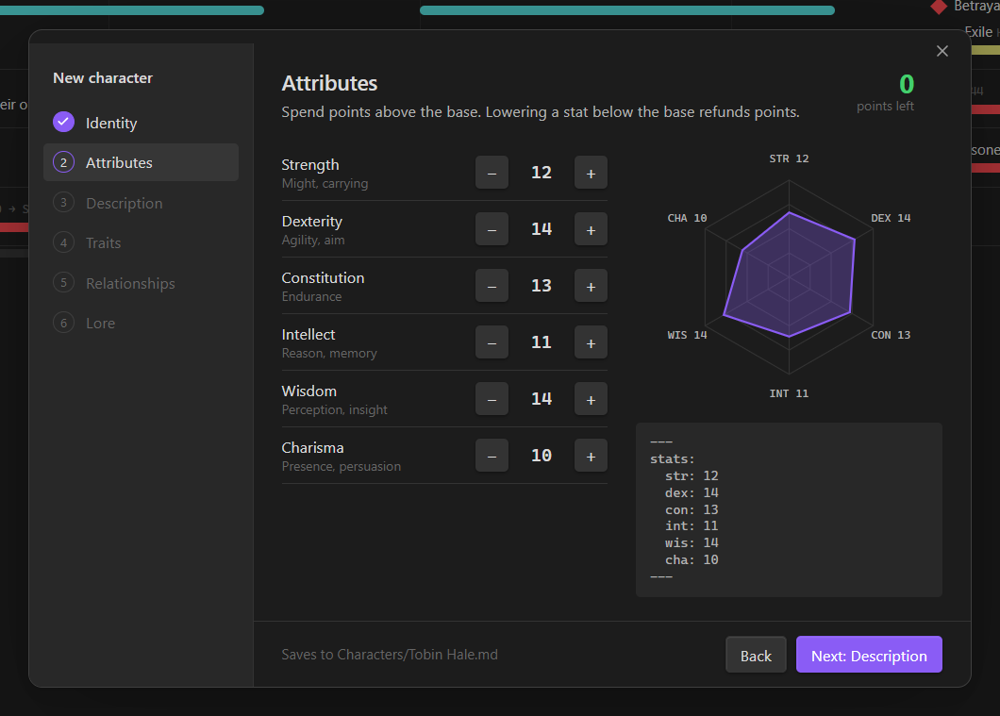 |
| **Description** | **Traits** |
| 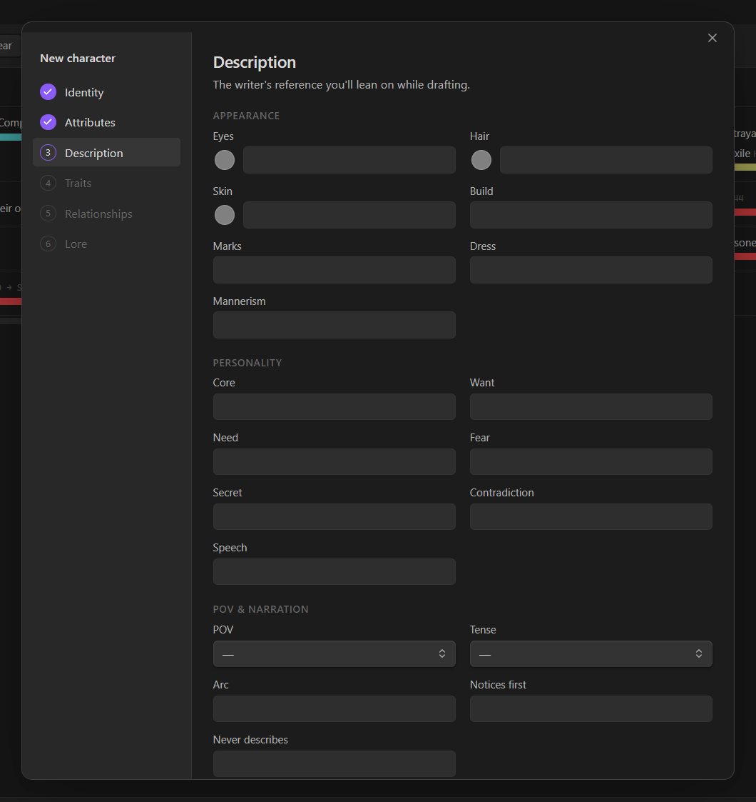 | 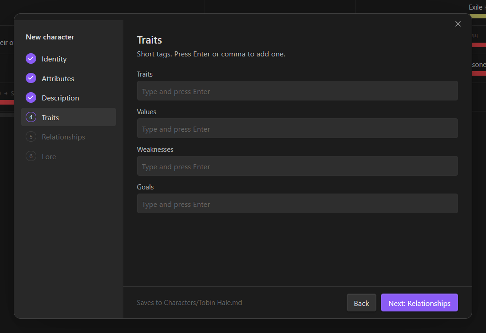 |
| **Relationships** | **Lore** |
| 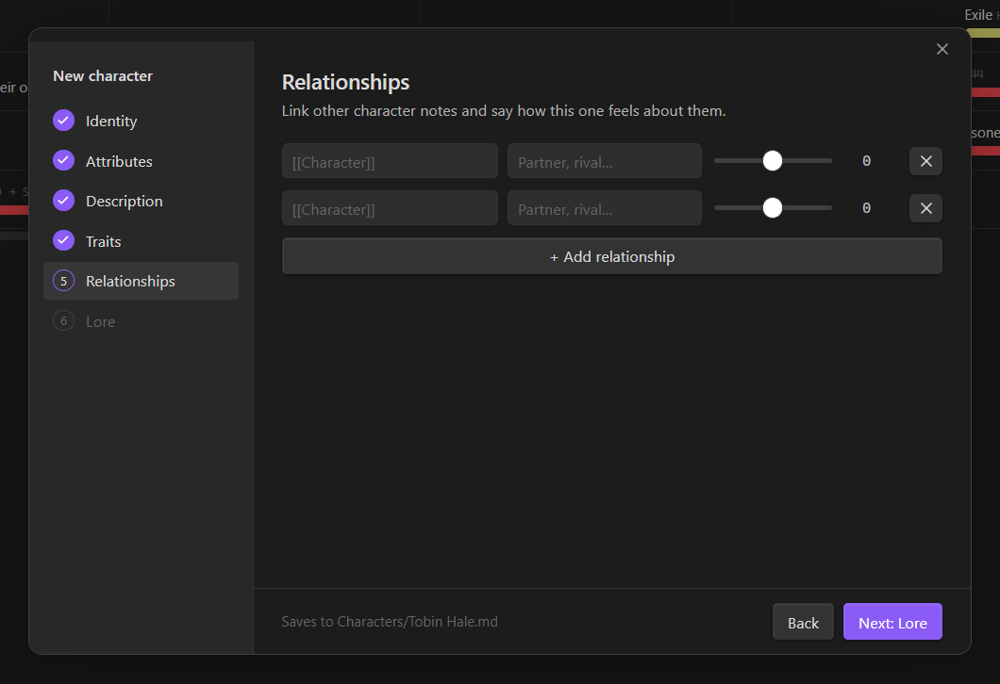 | 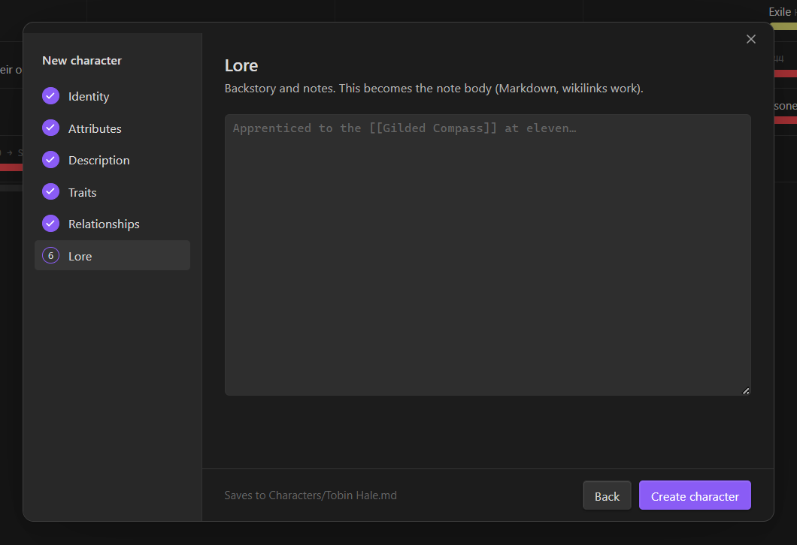 |

### Timeline

Use the **Open story timeline** command. It shows events on your custom calendar, with one lane per character plus World, Era/Year/Month zoom, drag to re-date, and drag a bar's right edge to change its end. Double-click an event to open it. Double-click an empty spot in a lane to create an event there.

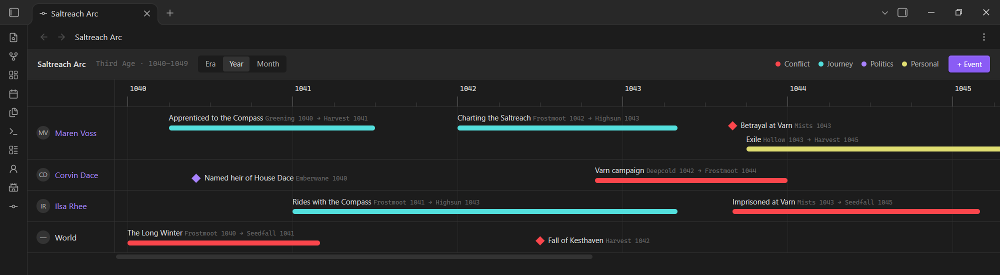

New events can also be created with **Create new timeline event** or the **+ Event** button:

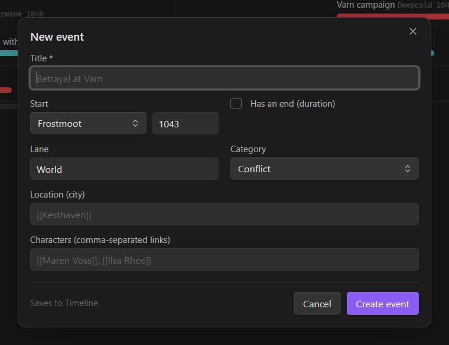

### Manuscript corkboard

Scenes connect the worldbuilding to the novel itself. A scene is a normal note with `type: scene` that holds the prose; its frontmatter links it to a POV character, a place and a timeline event. Use **Create new scene** to make one, and **Open manuscript corkboard** (or the book icon in the ribbon) to see them all.

The corkboard has one column per chapter, with scenes in reading order and a trailing *Unplaced* column for scenes without a chapter. Each card shows the summary, POV, location, the linked event with its in-world date, and a live word count from the note body. Drag cards to reorder them or move them to another chapter; the plugin rewrites `chapter` and `order` for you. Click a status pill to move it from draft to revised to final, filter by status or POV, and watch the toolbar meter for how much of the book is at each stage. Right-click a card, or use **Edit current note in wizard**, to change its details in a form.

### Canvas sync

The **Sync timeline to canvas** command writes `<Events folder>/<Timeline name>.canvas` in the open JSON Canvas format. Re-syncing keeps the positions you set by hand and only moves a card when its date changed. Optional reverse sync is in settings (experimental): drag a card sideways in the canvas to re-date the event.

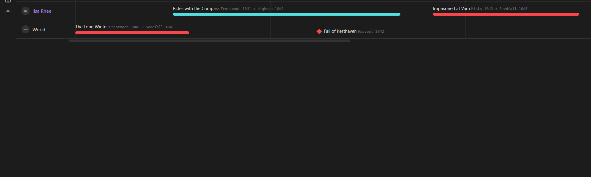

## Data model

See `example-vault/` for complete samples. Character notes use `type: character` and these keys: `name`, `quote`, `portrait`, `status`, `role`, `ancestry`, `born: { month, year }`, `affiliation`, `faction`, `faction_tag`, `story_role`, `vitals`, `stats`, `traits`, `values`, `weaknesses`, `goals`, `relationships`, `inventory` and `description`. Event notes look like this:

```yaml
---
type: event
title: Betrayal at Varn
tl-start: { month: 8, year: 1043 }
tl-end: { month: 2, year: 1045 }   # omit for point events
lane: "[[Maren Voss]]"             # or World
category: conflict
characters: ["[[Maren Voss]]"]
---
```

City notes look like this (see `example-vault/Places/Kesthaven.md`):

```yaml
---
type: city
name: Kesthaven
motto: "The tide keeps no ledger."
images: ["[[harbour.png]]", "[[night.png]]", "[[storm.png]]"]
region: "[[Saltreach]]"
founded: { month: 3, year: 612 }
population: 18400
ruler: "[[Corvin Dace]]"
languages: [Common, Saltreach cant]
districts:
  - { name: Harbour Ward, character: Docks and chandlers, notes: "Where [[Maren Voss]] grew up" }
landmarks:
  - { name: The Lantern Spire, kind: Lighthouse, notes: Dark since 1042 }
notable_people: ["[[Old Tamsin]]"]   # optional; characters whose notes link here are added automatically
---
```

Species notes look like this (see `example-vault/Species/Tidekin.md`):

```markdown
---
type: species
name: Tidekin
epithet: Children of the undertow.
images: ["[[portrait.png]]", "[[shoal.png]]"]
classification: Amphibious humanoid
range: "[[Saltreach]]"
lifespan: 90–120 years
variants:
  - { name: Deepkin, range: Trench caves, traits: "Pale, near-blind" }
abilities:
  - { name: Gill-breath, kind: Physiology, notes: Hours underwater }
notable_members: ["[[Old Tamsin]]"]
---
An amphibious people of the kelp shelves.   <- Overview

## Behaviour

Cautious with strangers, loyal once a debt is owed.

## Culture

History is sung in tide-chants.
```

Faction notes look like this (see `example-vault/Factions/`):

```markdown
---
type: faction
name: Gilded Compass
motto: Every route has a price.
leader: Guildmaster Ysolde Ost       # text or a [[link]] to a character
seat: "[[Kesthaven]]"
power: 7                             # 0–10
reputation: 3                        # −10 to +10
goals:
  - { text: Find who sold the route, done: false }
territory: ["[[Kesthaven]]"]
allies: ["[[House Dace]]"]
rivals: ["[[The Unmapped]]"]
resources:
  - { name: Chartroom of Ost, kind: Archive, notes: Six centuries of soundings }
members: ["[[Old Tamsin]]"]          # optional; characters with faction or affiliation set are added automatically
---
The guild of cartographers.   <- Overview
```

Events show up under "Events here" when they have `location: "[[Kesthaven]]"`.

### Scene

```yaml
---
type: scene
chapter: 1
order: 2                              # position within the chapter; the corkboard keeps this up to date
status: revised                       # draft | revised | final
pov: "[[Maren Voss]]"
location: "[[Kesthaven]]"
event: "[[Fall of Kesthaven]]"        # a timeline event; its date shows on the card
summary: The Compass offers Maren a contract she shouldn't take.
---
The prose. Word counts skip the frontmatter, %%comments%% and link syntax.
```

The title is the file name. Character sheets count how many scenes are from their POV. In a vault with no scene notes yet, every note in the manuscript folder with `pov: "[[Character]]"` counts instead.

## Settings

- Folders: characters, events, cities, species, factions, manuscript
- Calendar: era name and abbreviation, the 12 month names, the current story year
- Event categories: key, label and theme colour
- Description fields per group: add, remove, reorder, and set the type (text, colour, choice, long text)
- City sheet: the "At a glance" rows (key + label, reorderable) and the tables (frontmatter key, title, columns)
- Species sheet: the "At a glance" rows, the body sections (add, rename, reorder) and the tables
- Faction sheet: the "At a glance" rows and the tables
- Attribute rules
- Default sheet layout
- Auto-open character notes as sheets

| General | Categories and description fields | City sheet |
| --- | --- | --- |
| 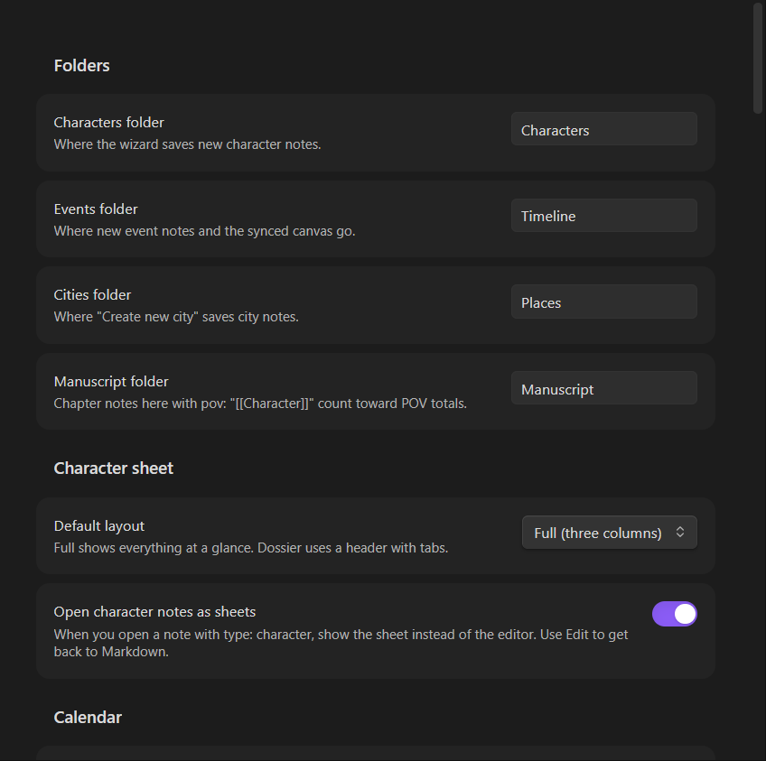 | 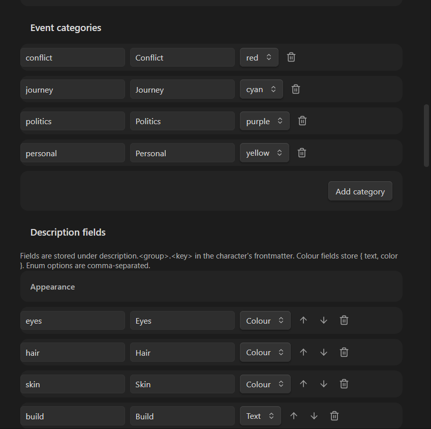 | 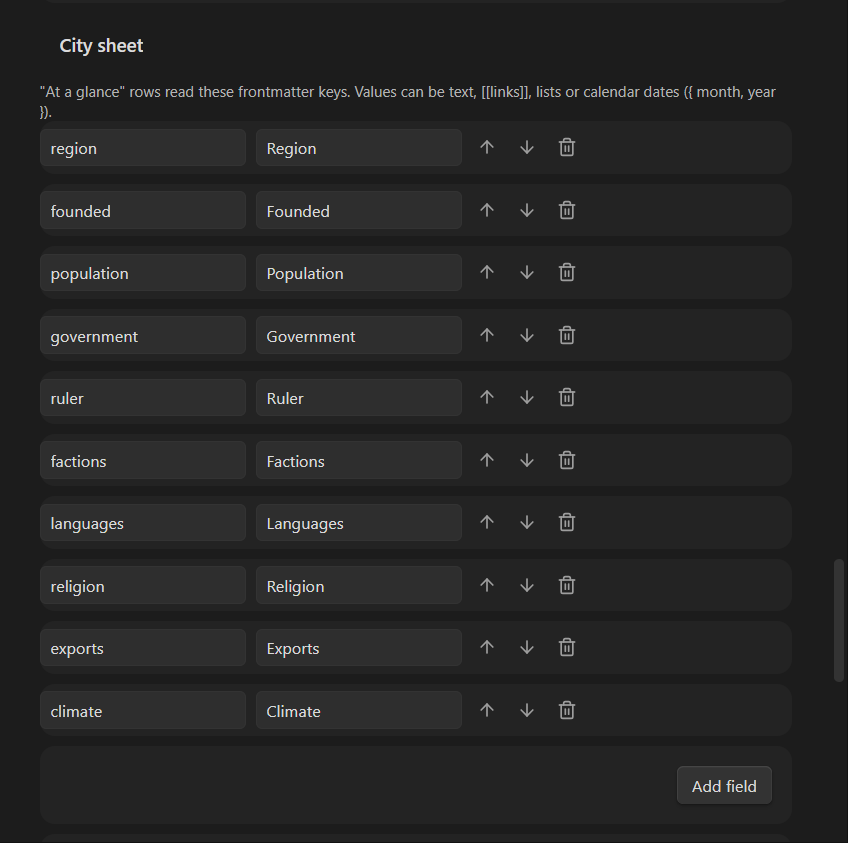 |

## Installing and updating

- **From Obsidian (once listed):** Settings → Community plugins → Browse → search "Worldbuilding". Updates arrive through **Check for updates**, or automatically if "Automatically check for plugin updates" is on.
- **Before it is listed, with BRAT:** install the [BRAT](https://github.com/TfTHacker/obsidian42-brat) plugin, choose "Add beta plugin", and paste `LRO-UI/Obsidian-Worldbuilding`. BRAT installs the latest release and keeps it updated.
- **By hand:** download `main.js`, `manifest.json` and `styles.css` from the latest [release](https://github.com/LRO-UI/Obsidian-Worldbuilding/releases) into `<vault>/.obsidian/plugins/worldbuilding/`.

## Publishing a new version

```bash
npm version patch   # or minor / major: bumps package.json, manifest.json and versions.json, commits and tags
git push --follow-tags
```

Pushing the tag runs `.github/workflows/release.yml`, which builds the plugin and publishes a GitHub release with `main.js`, `manifest.json` and `styles.css`. Obsidian and BRAT pick it up from there.

## Development

```bash
npm install
npm run build              # type-check + bundle to main.js
npm run dev                # watch mode
npm run install-example    # build and copy into example-vault/
npm run install-vault -- "C:/path/to/YourVault"   # copy a build into any vault
```

Then enable **Worldbuilding** under Settings → Community plugins.

Colours come only from Obsidian theme variables, so the plugin follows light and dark themes. All classes use the `ct-` prefix.
